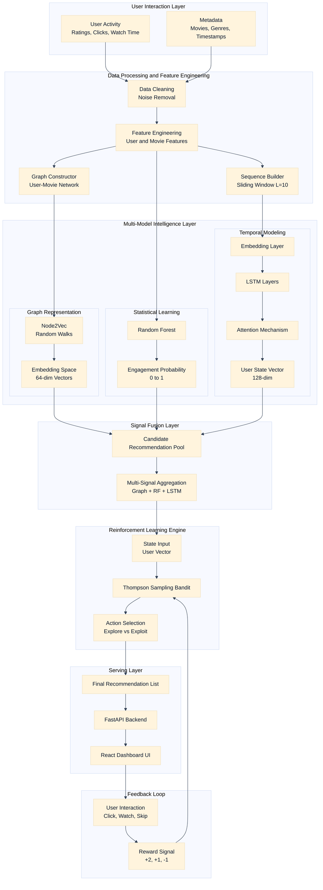

# CinePulse 🎬

> **An AI system for predicting and optimizing user engagement through multi-model signal fusion**

[](https://python.org)
[](https://pytorch.org)
[](https://fastapi.tiangolo.com)
[](https://react.dev)
[](https://vitejs.dev)

CinePulse is a research-grade recommendation system built as a final-year Capstone Project at VIT Bhopal University. It runs four different AI models on the same user simultaneously (Graph, Random Forest, Sequential LSTM, and Reinforcement Learning) and keeps the decision process transparent through model-wise outputs and reasoning.

---

## What makes this different

Most recommendation systems ask: *"What does this user like?"*

CinePulse asks four different questions at once:

| Model | Question asked |
|-------|----------------|
| **M1 - Node2Vec Graph** | Who does this user resemble structurally in the interaction graph? |
| **M2 - Random Forest** | What is the probability this user engages, based on tabular features? |
| **M3 - Attention-LSTM** | Given the order of this user's last 10 movies, what comes next? |
| **M4 - RL Bandit** | Which strategy maximizes long-term engagement from feedback? |

The RL agent adapts based on live user feedback events (liked/watched/disliked), improving strategy without retraining the full pipeline.

---

## Live Demo Flow

```text
Select a userId (1-610)
        |
All 4 models run from the same backend API
        |
User Intelligence panel summarizes behavior
        |
2x2 model grid shows each model's top predictions
        |
Final recommendation banner surfaces optimized choice
        |
"Why this recommendation?" explains model consensus
        |
User submits feedback (Liked / Watched / Disliked)
        |
Bandit agent updates reward history immediately
```

---

## Results

| Metric | Value | Context |
|--------|-------|---------|
| **HR@10** | **8.14%** | About 80x above random baseline (~0.1%) |
| **NDCG@10** | **0.0457** | Position-weighted ranking quality |
| **Pipeline AUC** | **0.84** | vs 0.74 for baseline alone (+10 pts) |
| **Regret reduction** | **61%** | RL agent over 5,000 episodes |

---

## Architecture

```text
MovieLens Dataset (ratings.csv, movies.csv, tags.csv)
              |
    +---------+----------+
    |         |          |
    v         v          v
M1 Graph   M2 RF     M3 LSTM
Node2Vec   Baseline  Attention-LSTM
64-dim     prob 0-1  128-dim state
    +---------+----------+
              |
              v
         M4 RL Bandit
      Thompson Sampling
              |
              v
    FastAPI + React Dashboard
      Explainable recommendations
      + live feedback tracking
```

## System Architecture Diagram



---

## Project Structure

```text
Capstone_Final/
|
+-- backend/
|   +-- app.py                             # FastAPI entry point + endpoints
|   +-- config.py                          # backend settings
|   +-- requirements.txt
|   +-- README.md
|   +-- .env.example
|
+-- frontend/
|   +-- src/
|   |   +-- pages/
|   |   |   +-- Landing.jsx
|   |   |   +-- Dashboard.jsx              # Main 4-model comparison hub
|   |   |   +-- Compare.jsx                # Side-by-side model comparison
|   |   |   +-- Recommendations.jsx        # Predict page
|   |   |   +-- Metrics.jsx                # Charts + model metrics
|   |   |   +-- About.jsx
|   |   +-- layouts/
|   |   |   +-- AppLayout.jsx
|   |   +-- context/
|   |   |   +-- UserContext.jsx
|   |   +-- lib/
|   |       +-- recommendations.js         # API helpers
|   +-- package.json
|   +-- vite.config.js
|
+-- Feature Engineering + Baseline Model/
|   +-- train_model.py
|   +-- predict_engagement.py
|   +-- rf_model.pkl
|   +-- ml-latest-small/
|
+-- GraphModel/
|   +-- GraphModel.ipynb
|   +-- node2vec_model.pkl
|   +-- movie_embeddings.txt
|   +-- movies.csv
|   +-- ratings.csv
|
+-- SequentialDeepLearningModel/
|   +-- src/
|   |   +-- model.py
|   |   +-- extract_states.py
|   +-- models/
|   |   +-- lstm_model.pt
|   +-- data/
|       +-- movie2idx.json
|       +-- movies.csv
|       +-- ratings.csv
|
+-- Reinforcement_Learning_Recommender/
|   +-- main.py
|   +-- mab_recommender.py
|   +-- prediction_eval.py
|   +-- train_mab.py
|   +-- models/
|   |   +-- mab_agent_thompson.pkl
|   +-- data/
|       +-- feedback_store.json
|       +-- movies.csv
|       +-- ratings.csv
|
+-- Dataset/
+-- Run.txt
+-- README.md
```

---

## Getting Started

### Prerequisites

```bash
Python 3.9+
Node.js 18+
pip
npm
```

### 1. Clone repository

```bash
git clone <your-repo-url>
cd Capstone_Final
```

### 2. Frontend only (quick start)

```bash
cd frontend
npm install
npm run dev
```

Frontend runs at: `http://localhost:5173`

### 3. Full stack setup

```bash
# From Capstone_Final/
cd backend
python -m venv venv

# Windows
venv\Scripts\activate

# macOS / Linux
source venv/bin/activate

pip install -r requirements.txt

# New terminal
cd ../frontend
npm install
npm run dev

# Back in backend terminal
cd ../backend
uvicorn app:app --host 127.0.0.1 --port 8000 --reload
```

Backend runs at: `http://127.0.0.1:8000`
API docs at: `http://127.0.0.1:8000/docs`

---

## API Reference

### Health Check

```http
GET /health
```

Response:

```json
{ "status": "ok" }
```

---

### Core Recommendation Endpoint

```http
POST /api/recommendations
```

```json
{
  "userId": 1,
  "topK": 10,
  "algorithm": "RL (Bandit)"
}
```

`algorithm` accepts: `"RL (Bandit)"` · `"Baseline (RF)"` · `"Graph (Node2Vec)"` · `"Sequential (LSTM)"`

Response:

```json
{
  "userId": 1,
  "algorithm": "RL (Bandit)",
  "recommendations": [
    {
      "rank": 1,
      "movieId": 527,
      "title": "Schindler's List (1993)",
      "genres": "Drama|War",
      "score": 1.803
    }
  ]
}
```

---

### User Intelligence Endpoint

```http
GET /api/user-intelligence/{user_id}
```

Returns dominant genre, trend, engagement label, sequence insight, and confidence score.

---

### User Profile Endpoint

```http
GET /api/user-profile/{user_id}
```

Returns real watch history, total ratings, average rating, dominant genre, and top genres.

---

### Feedback Endpoint (Model Learning Signal)

```http
POST /api/feedback
```

```json
{
  "userId": 1,
  "movieId": 527,
  "movieTitle": "Schindler's List (1993)",
  "feedbackType": "liked"
}
```

`feedbackType` accepts: `"liked"` · `"watched"` · `"disliked"`

---

### Feedback Stats

```http
GET /api/feedback/stats
```

Returns feedback totals, positive rate, type distribution, and recent logs.

---

### Engagement Tracking Endpoint

```http
POST /api/engagement-track
```

Tracks click/watch/rating style events from the frontend interaction layer.

---

## Dashboard Pages

| Route | Page | Description |
|------|------|-------------|
| `/` | Landing | Project overview, value proposition, metrics snapshot |
| `/dashboard` | Dashboard | User intelligence + 4 model outputs + final recommendation |
| `/compare` | Compare Models | Side-by-side model behavior and overlap |
| `/predict` | Predict | Single-model view with score labels and details |
| `/metrics` | Metrics | Training charts, evaluation metrics, and progress |
| `/about` | About | Team and capstone context |

---

## Model Details

### M1 - Graph Representation Learning (Node2Vec)

Builds a user-movie interaction graph and uses Node2Vec embeddings to capture structural similarity patterns.

- Output artifact: `GraphModel/movie_embeddings.txt`
- Embedding size: 64 dimensions

### M2 - Baseline ML (Random Forest)

Learns engagement probability from engineered tabular features (user stats + movie stats + genres/year signals).

- Output artifact: `Feature Engineering + Baseline Model/rf_model.pkl`
- Baseline AUC: 0.74

### M3 - Sequential Deep Learning (Attention-LSTM)

Models temporal behavior from each user's recent watch sequence (length 10) and predicts likely next items.

- Output artifact: `SequentialDeepLearningModel/models/lstm_model.pt`
- Key representation: 128-dim hidden state
- HR@10: 8.14%

### M4 - Reinforcement Learning Agent (Thompson Sampling)

Optimizes long-term reward with exploration/exploitation tradeoff based on observed feedback.

- Output artifact: `Reinforcement_Learning_Recommender/models/mab_agent_thompson.pkl`
- Regret reduction: 61% over training episodes

---

## Key Design Decisions

- **Model transparency first**: each model output is visible before the final RL-optimized choice.
- **Unified algorithm API contract**: all model calls use the same `/api/recommendations` schema.
- **Shared data vocabulary**: `movie2idx.json` ensures consistent indexing for sequential modeling and integration.
- **Immediate feedback loop**: feedback and engagement endpoints allow online adaptation signals.
- **Capstone-friendly modularity**: each model module lives in a separate folder for independent experimentation.

---

## Troubleshooting

### Frontend will not start

```bash
cd frontend
rm -rf node_modules package-lock.json
npm install
npm run dev
```

### Backend will not start

```bash
cd backend
python --version
# Should be 3.9+

# Activate venv first, then reinstall
pip install --upgrade -r requirements.txt
```

### CORS or connection errors

- Ensure backend is running on `127.0.0.1:8000`
- Ensure frontend is running on `localhost:5173`
- Restart backend after changing backend environment variables

### Model file missing errors

Verify these files exist:

- `Feature Engineering + Baseline Model/rf_model.pkl`
- `GraphModel/movie_embeddings.txt`
- `SequentialDeepLearningModel/models/lstm_model.pt`
- `Reinforcement_Learning_Recommender/models/mab_agent_thompson.pkl`

---

## Technical Stack

### Frontend

- React 19 + React Router
- Vite
- Tailwind CSS
- Chart.js / react-chartjs-2

### Backend

- FastAPI + Uvicorn
- Pydantic / pydantic-settings
- NumPy, Pandas
- Scikit-learn (RF)
- PyTorch (LSTM)
- Joblib

### Data

- MovieLens ml-latest-small

---

## Team

| Name | Register No | Module |
|------|-------------|--------|
| Harsh Kumar | 22BCE11405 | M5 - Backend Integration and React Dashboard |
| Ayush Raj | 22BCE10636 | M1 - Graph Representation Learning (Node2Vec) |
| Om Milind Kabade | 22BCE10890 | M2 - Feature Engineering and Random Forest Baseline |
| Vikesh Mehta | 22BCE11631 | M4 - Reinforcement Learning Agent (Thompson Sampling) |
| Ishan Peshkar | 22BCE10502 | M3 - Sequential Deep Learning (Attention-LSTM) |

Supervisor: Mr. Chour Singh Rajpoot
Institution: VIT Bhopal University, Department of Computer Science and Engineering
Course: DSN4095 - Capstone Project Phase II
Year: 2026

---

## Dataset

This project uses the [MovieLens ml-latest-small](https://grouplens.org/datasets/movielens/latest/) dataset.

Citation:
F. Maxwell Harper and Joseph A. Konstan. 2015. *The MovieLens Datasets: History and Context*. ACM Transactions on Interactive Intelligent Systems, 5(4):19.

If needed, download from [grouplens.org](https://grouplens.org/datasets/movielens/latest/) and place files in model-specific data folders.

---

## References

1. Koren, Y., Bell, R., Volinsky, C. - Matrix Factorization Techniques for Recommender Systems - IEEE Computer, 2009
2. Hidasi, B. et al. - Session-based Recommendations with Recurrent Neural Networks - ICLR, 2016
3. Grover, A., Leskovec, J. - node2vec: Scalable Feature Learning for Networks - KDD, 2016
4. Chapelle, O., Li, L. - An Empirical Evaluation of Thompson Sampling - NeurIPS, 2011
5. Hochreiter, S., Schmidhuber, J. - Long Short-Term Memory - Neural Computation, 1997

---

## License

Academic Research Project - VIT Bhopal (Capstone).

---

<p align="center">
  Built at VIT Bhopal University · Capstone Project Phase II · March 2026
</p>
